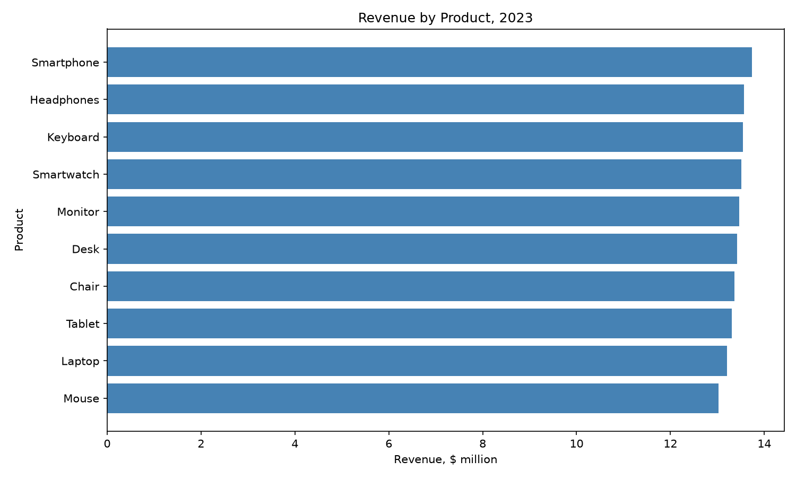
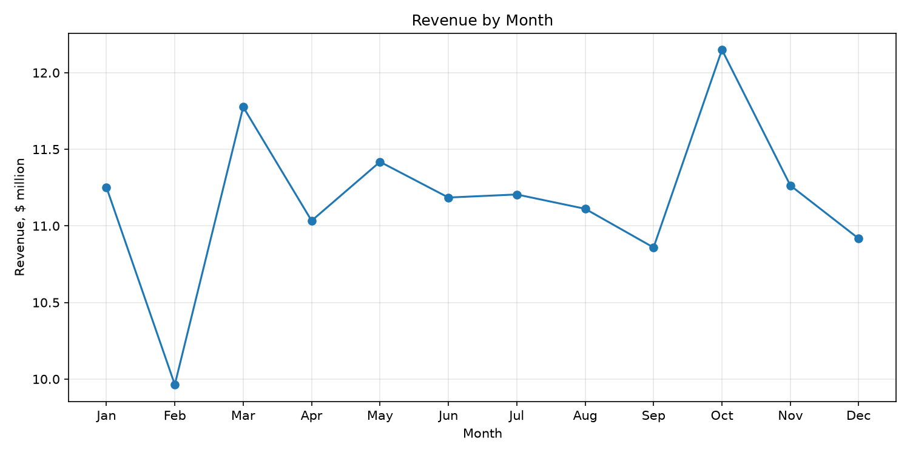
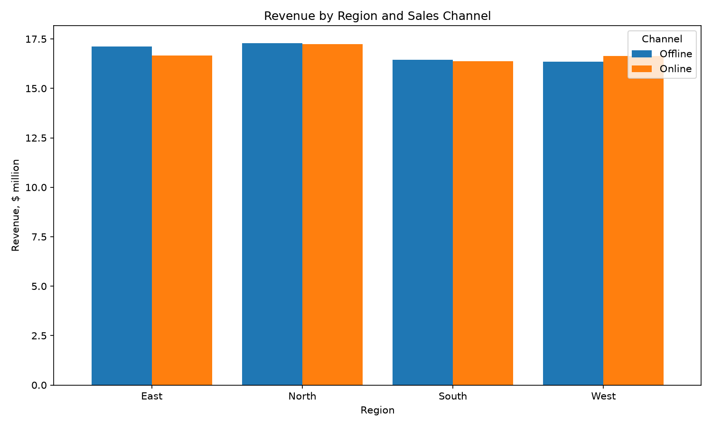

# Sales Data Analysis (Python, pandas, Matplotlib)

Exploratory analysis of an e-commerce sales dataset with ~50,000 orders. The goal is to understand where revenue comes from and when customers buy.

## What this project does

- Loads and cleans sales data from Excel (`Sales_Data.xlsx`)
- Calculates revenue per order (`Quantity x Price_per_Unit`)
- Analyzes revenue by product, region, month, weekday and sales channel
- Compares months fairly using average daily revenue
- Studies distributions (unit price, order revenue) and checks the correlation between price and quantity
- Flags a data-quality issue: the `Category` column does not match real product logic
- Saves 10 charts and prints a short insight for each

## Key findings

- Revenue is spread almost evenly across products: Smartphone leads (~$14M), Mouse is lowest (~$13M)
- North is the top region (25.7% of revenue), South is the lowest (24.5%)
- October is the strongest month (~$12M), February the weakest (~$10M). Average daily revenue gives a fairer comparison because months differ in length
- Sales peak on Sunday ($19.62M) and are lowest on Friday ($18.77M)
- Order revenue is right-skewed: mean $2,682.69 vs median $2,054.27, so the median describes a typical order better
- Price and quantity are not correlated (correlation 0.0005)

## Charts





## How to run

```bash
pip install -r requirements.txt
python sales_analysis.py
```

Keep `Sales_Data.xlsx` in the same folder as the script.

## Tools

Python, pandas, Matplotlib

